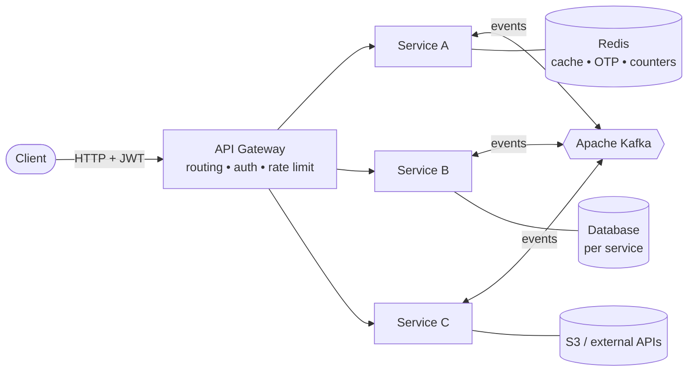

<!-- ============ HEADER ============ -->
<div align="center">


<a href="https://github.com/Shaikh-NM">
  
</a>

<br/>

<a href="https://www.linkedin.com/in/sk-nishan-mondal-b7544425b/"></a>
<a href="mailto:wizice855@gmail.com"></a>
<a href="https://github.com/Shaikh-NM?tab=repositories"></a>


</div>

<br/>

## ⚡ whoami

```java
public class Nishan implements SoftwareEngineer {

    String focus       = "High-throughput distributed systems & low-latency microservices";
    String daily       = "Spring Boot • Kafka • Redis • Docker • Kubernetes";
    String learning    = "Distributed consensus • Multi-agent LLM systems • eBPF tracing";
    String lookingFor  = "Open-source backend infra & performance engineering";

    public void superpower() {
        optimize("algorithm").shaveOff("10ms");   // can lose hours here
    }
}
```

<br/>

## 🚀 Featured Projects

<div align="center">

<a href="https://github.com/Shaikh-NM/banking-backend-core">
  
</a>
<a href="https://github.com/Shaikh-NM/netflix-streaming-core">
  
</a>
<a href="https://github.com/Shaikh-NM/stock-trading-platform">
  
</a>

</div>

<br/>

<table>
<tr>
<td width="33%" valign="top">

### 🏦 [Banking Backend Core](https://github.com/Shaikh-NM/banking-backend-core)
*Event-driven digital banking platform*

- 🔁 **Saga orchestration** with compensating refunds, so no transfer is left half-done
- 🛡️ **Real-time fraud engine**: velocity, unusual amount, balance usage
- 🔐 **OTP verification** with 5-min TTL in Redis
- 🚦 Redis rate limiting at the gateway
- 💳 Razorpay payments + webhooks

<a href="https://docs.oracle.com/en/java/"></a>
<a href="https://docs.spring.io/spring-boot/"></a>
<a href="https://kafka.apache.org/documentation/"></a>
<a href="https://redis.io/docs/"></a>
<a href="https://dev.mysql.com/doc/"></a>

</td>
<td width="33%" valign="top">

### 🎬 [Netflix Streaming Core](https://github.com/Shaikh-NM/netflix-streaming-core)
*Video ingestion, encoding & adaptive playback*

- 📤 Raw uploads to **AWS S3**
- 🎞️ **FFmpeg** multi-resolution encoding (240p → 1080p)
- 📺 **HLS** adaptive bitrate streaming
- ⚡ Upload and encoding decoupled via Kafka
- 🔒 Private bucket + time-limited signed URLs

<a href="https://docs.oracle.com/en/java/"></a>
<a href="https://docs.spring.io/spring-boot/"></a>
<a href="https://kafka.apache.org/documentation/"></a>
<a href="https://docs.aws.amazon.com/s3/"></a>
<a href="https://ffmpeg.org/documentation.html"></a>

</td>
<td width="33%" valign="top">

### 📈 [Stock Trading Platform](https://github.com/Shaikh-NM/stock-trading-platform)
*Live market data with AI trade analysis*

- 🧩 **9 microservices** behind a JWT-secured gateway
- 💹 **WebSocket** real-time price streaming
- 🤖 **Claude-powered** trade analysis before you confirm
- 📊 Event-driven orders → funds → portfolio → alerts
- ⚡ Redis-cached price lookups

<a href="https://docs.oracle.com/en/java/"></a>
<a href="https://docs.spring.io/spring-boot/"></a>
<a href="https://kafka.apache.org/documentation/"></a>
<a href="https://developer.mozilla.org/docs/Web/API/WebSockets_API"></a>
<a href="https://docs.claude.com"></a>

</td>
</tr>
</table>

<details>
<summary><b>🧠 The pattern behind all three (click to expand)</b></summary>
<br/>



Synchronous calls only where an immediate answer is required; everything else flows through events, with idempotent consumers and compensating actions for failure.

</details>

<br/>

## 🛠️ Tech Arsenal

<div align="center">

**Languages**<br/>
<a href="https://docs.oracle.com/en/java/" target="_blank" rel="noreferrer"></a>
<a href="https://go.dev/doc/" target="_blank" rel="noreferrer"></a>
<a href="https://docs.python.org/3/" target="_blank" rel="noreferrer"></a>
<a href="https://en.cppreference.com/" target="_blank" rel="noreferrer"></a>
<a href="https://learn.microsoft.com/dotnet/csharp/" target="_blank" rel="noreferrer"></a>
<a href="https://www.typescriptlang.org/docs/" target="_blank" rel="noreferrer"></a>
<a href="https://developer.mozilla.org/docs/Web/JavaScript" target="_blank" rel="noreferrer"></a>
<a href="https://docs.scala-lang.org/" target="_blank" rel="noreferrer"></a>
<a href="https://www.gnu.org/software/bash/manual/" target="_blank" rel="noreferrer"></a>

<br/><br/>

**Backend & Frameworks**<br/>
<a href="https://docs.spring.io/spring-boot/" target="_blank" rel="noreferrer"></a>
<a href="https://fastapi.tiangolo.com/" target="_blank" rel="noreferrer"></a>
<a href="https://docs.nestjs.com/" target="_blank" rel="noreferrer"></a>
<a href="https://nodejs.org/docs/latest/api/" target="_blank" rel="noreferrer"></a>
<a href="https://docs.djangoproject.com/" target="_blank" rel="noreferrer"></a>
<a href="https://learn.microsoft.com/dotnet/" target="_blank" rel="noreferrer"></a>
<a href="https://graphql.org/learn/" target="_blank" rel="noreferrer"></a>
<a href="https://nextjs.org/docs" target="_blank" rel="noreferrer"></a>

<br/><br/>

**Messaging, Streaming & Data**<br/>
<a href="https://kafka.apache.org/documentation/" target="_blank" rel="noreferrer"></a>
<a href="https://www.rabbitmq.com/docs" target="_blank" rel="noreferrer"></a>
<a href="https://redis.io/docs/" target="_blank" rel="noreferrer"></a>
<a href="https://www.postgresql.org/docs/" target="_blank" rel="noreferrer"></a>
<a href="https://dev.mysql.com/doc/" target="_blank" rel="noreferrer"></a>
<a href="https://www.mongodb.com/docs/" target="_blank" rel="noreferrer"></a>
<a href="https://cassandra.apache.org/doc/latest/" target="_blank" rel="noreferrer"></a>
<a href="https://www.elastic.co/docs" target="_blank" rel="noreferrer"></a>
<a href="https://docs.aws.amazon.com/dynamodb/" target="_blank" rel="noreferrer"></a>

<br/>
<a href="https://spark.apache.org/docs/latest/" target="_blank" rel="noreferrer"></a>
<a href="https://airflow.apache.org/docs/" target="_blank" rel="noreferrer"></a>
<a href="https://neo4j.com/docs/" target="_blank" rel="noreferrer"></a>
<br/><br/>

**Cloud & DevOps**<br/>
<a href="https://docs.aws.amazon.com/" target="_blank" rel="noreferrer"></a>
<a href="https://cloud.google.com/docs" target="_blank" rel="noreferrer"></a>
<a href="https://learn.microsoft.com/azure/" target="_blank" rel="noreferrer"></a>
<a href="https://docs.docker.com/" target="_blank" rel="noreferrer"></a>
<a href="https://kubernetes.io/docs/" target="_blank" rel="noreferrer"></a>
<a href="https://nginx.org/en/docs/" target="_blank" rel="noreferrer"></a>
<a href="https://docs.github.com/actions" target="_blank" rel="noreferrer"></a>
<a href="https://docs.gitlab.com/ee/ci/" target="_blank" rel="noreferrer"></a>
<a href="https://www.jenkins.io/doc/" target="_blank" rel="noreferrer"></a>
<a href="https://git-scm.com/doc" target="_blank" rel="noreferrer"></a>
<a href="https://www.kernel.org/doc/" target="_blank" rel="noreferrer"></a>

<br/><br/>

**AI & Machine Learning**<br/>
<a href="https://pytorch.org/docs/" target="_blank" rel="noreferrer"></a>
<a href="https://www.tensorflow.org/api_docs" target="_blank" rel="noreferrer"></a>
<a href="https://scikit-learn.org/stable/user_guide.html" target="_blank" rel="noreferrer"></a>

<br/>
<a href="https://huggingface.co/docs" target="_blank" rel="noreferrer"></a>
<br/><br/>

<a href="https://docs.claude.com" target="_blank" rel="noreferrer"></a>
<a href="https://langchain-ai.github.io/langgraph/" target="_blank" rel="noreferrer"></a>
<a href="https://platform.openai.com/docs" target="_blank" rel="noreferrer"></a>
<a href="https://docs.ollama.com" target="_blank" rel="noreferrer"></a>

</div>

<br/>

## 📊 GitHub Stats

<div align="center">


</div>

<br/>

## 🐍 Contribution Snake

<div align="center">

<picture>
  <source media="(prefers-color-scheme: dark)" srcset="https://raw.githubusercontent.com/Shaikh-NM/Shaikh-NM/output/github-snake-dark.svg" />
  <source media="(prefers-color-scheme: light)" srcset="https://raw.githubusercontent.com/Shaikh-NM/Shaikh-NM/output/github-snake.svg" />
  
</picture>

</div>

<br/>

## 🤝 Let's Build Something

<div align="center">

I enjoy talking about **backend architecture, Kafka, Kubernetes, and performance engineering**.<br/>
Open to collaborating on **open-source backend infrastructure** and **low-latency API tooling**.

<br/>

<a href="https://www.linkedin.com/in/sk-nishan-mondal-b7544425b/"></a>
<a href="mailto:wizice855@gmail.com"></a>

</div>


